<picture>
  <source media="(prefers-color-scheme: dark)" srcset="docs/readme/banner-dark.svg" />
  
</picture>

<h3 align="center">Your members, in good standing.</h3>

<p align="center">
  <a href="CHANGELOG.md"></a>
  <a href="LICENSE"></a>
  <a href="https://github.com/SpaceWorks-Labs/SpaceWorks-Organization/actions/workflows/tests.yml"></a>
  <a href="https://github.com/SpaceWorks-Labs/SpaceWorks-Organization/actions/workflows/release.yml"></a>
</p>

<p align="center">
  <a href="#documentation">Documentation</a> ·
  <a href="#design-system">Design system</a> ·
  <a href="#quickstart">Get started</a>
</p>

**Space Works Organization is free, open-source membership software for clubs, associations, alumni bodies and
federations.** Publish your plans, take join applications, approve members, collect fees online or in hand, issue
GST-correct receipts and member cards anyone can check with a scan, chase renewals on every channel your members use,
and read the year at a glance, all from one app you host yourself or use on a shared platform. It is built for the
secretaries and treasurers who do all of this by hand today, with spreadsheets, UPI screenshots and receipt books,
and for Indian organisations first: the April–March year, GST and UPI are built in.

The core guarantee: money is never edited, only reversed. Receipt numbers are gapless per organisation per financial
year, paid rows are immutable, and corrections are credit notes. One deployment hosts **many organisations**, each
with its own plans, members, money and pages, fully isolated from the others. It is part of the
[Space Works](https://github.com/SpaceWorks-Labs/SpaceWorks) family and shares its design system, installer and
release pipeline.

## Contents

[A look around](#a-look-around) · [Quickstart](#quickstart) · [Who it is for](#who-it-is-for) ·
[What you can do](#what-you-can-do) · [Integrations](#integrations) · [Areas](#areas) ·
[Install options and hosting](#install-options-and-hosting) · [Architecture](#architecture) · [API](#api) ·
[Roles and access](#roles-and-access) · [Design system](#design-system) · [Documentation](#documentation) ·
[Roadmap](#roadmap) · [Contributing](#contributing) · [Licence](#licence)

## A look around

Every screen comes in light and dark. The light versions are shown first; the dark ones are under **Dark mode**.

<table>
  <tr>
    <td width="50%" valign="top">
      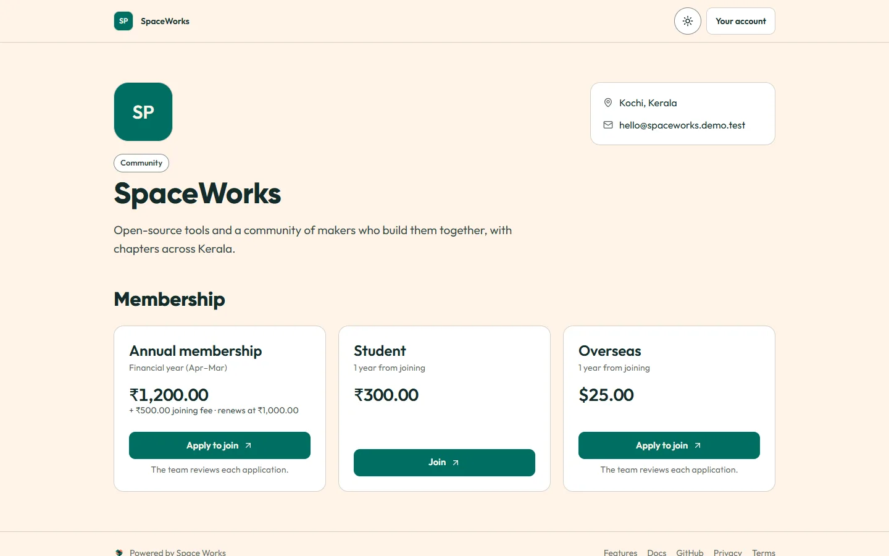
      <p><strong>Public page.</strong> Every plan, and one clear way to join.</p>
    </td>
    <td width="50%" valign="top">
      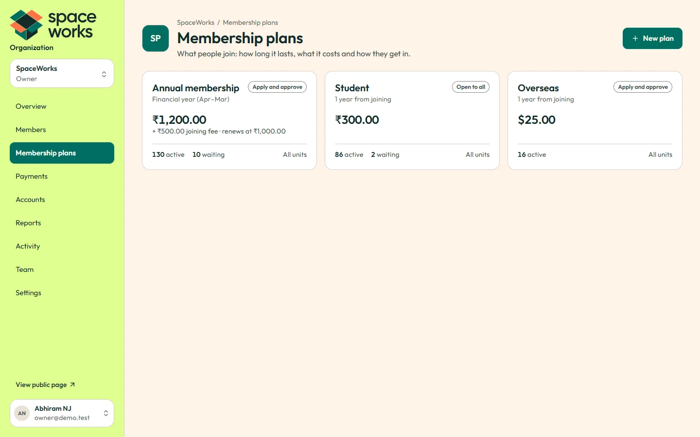
      <p><strong>Plans and join forms.</strong> Prices, payment modes and the questions each plan asks.</p>
    </td>
  </tr>
  <tr>
    <td width="50%" valign="top">
      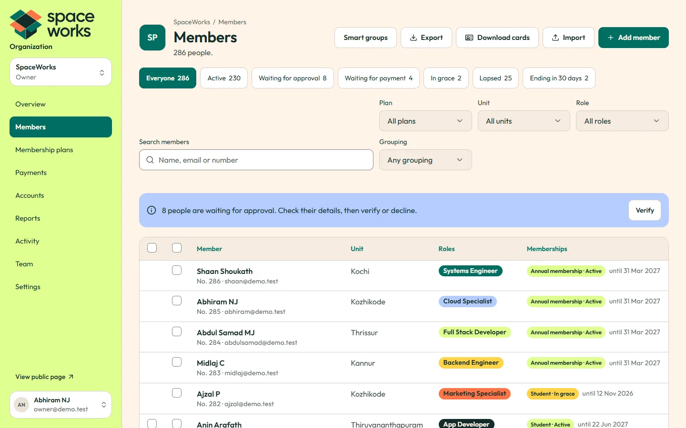
      <p><strong>Members.</strong> Who is active, waiting, in grace or lapsed, filtered your way.</p>
    </td>
    <td width="50%" valign="top">
      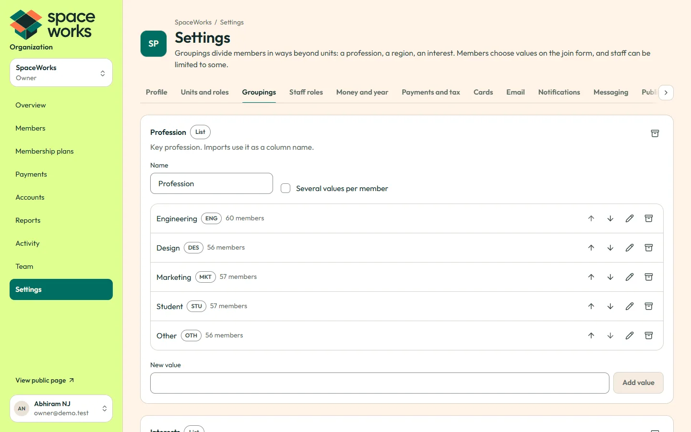
      <p><strong>Groupings.</strong> Profession, region, batch: any dimension, with smart groups on top.</p>
    </td>
  </tr>
  <tr>
    <td width="50%" valign="top">
      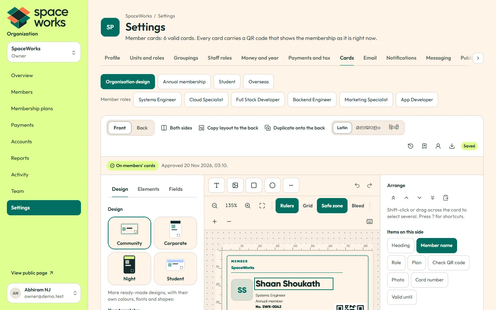
      <p><strong>Card designer.</strong> Front and back edited the same way, approved by the owner.</p>
    </td>
    <td width="50%" valign="top">
      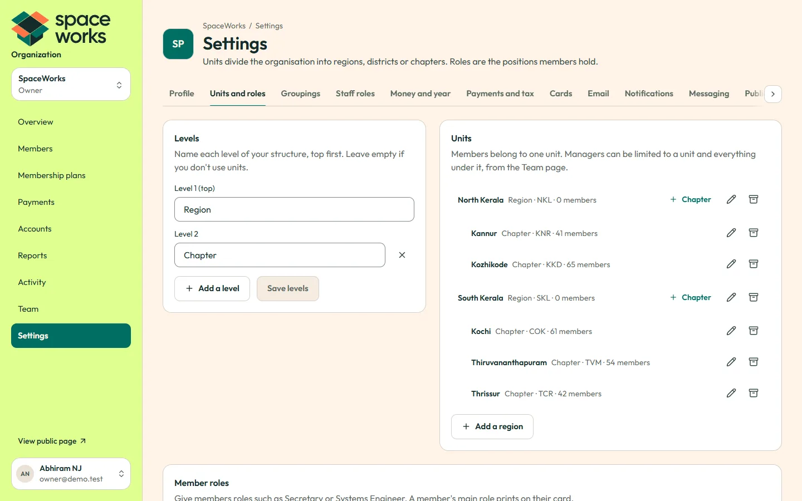
      <p><strong>Units.</strong> Regions and chapters, with staff limited to their own.</p>
    </td>
  </tr>
  <tr>
    <td width="50%" valign="top">
      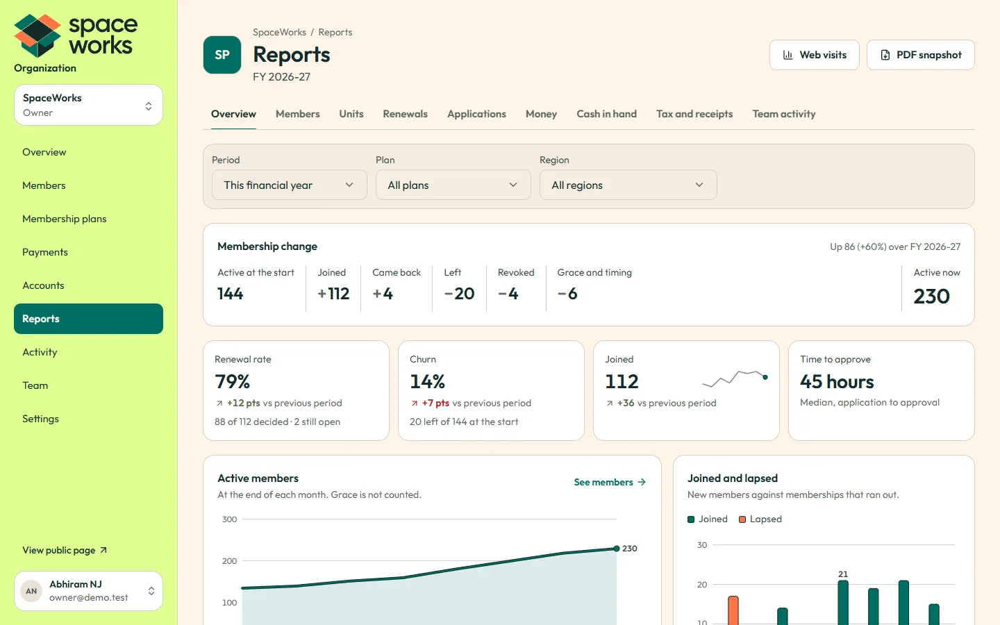
      <p><strong>Reports.</strong> The year at a glance, for the committee.</p>
    </td>
    <td width="50%" valign="top">
      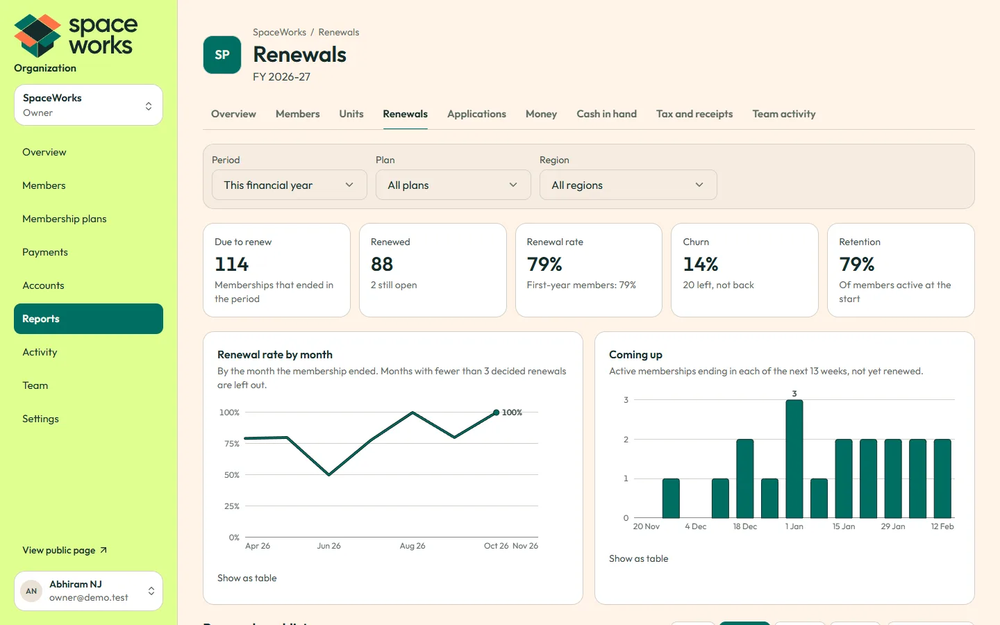
      <p><strong>Renewals.</strong> Who is due, who renewed and what is coming up.</p>
    </td>
  </tr>
</table>

<details>
<summary><strong>Dark mode</strong>: the same screens in the dark theme</summary>

<table>
  <tr>
    <td width="50%" valign="top">
      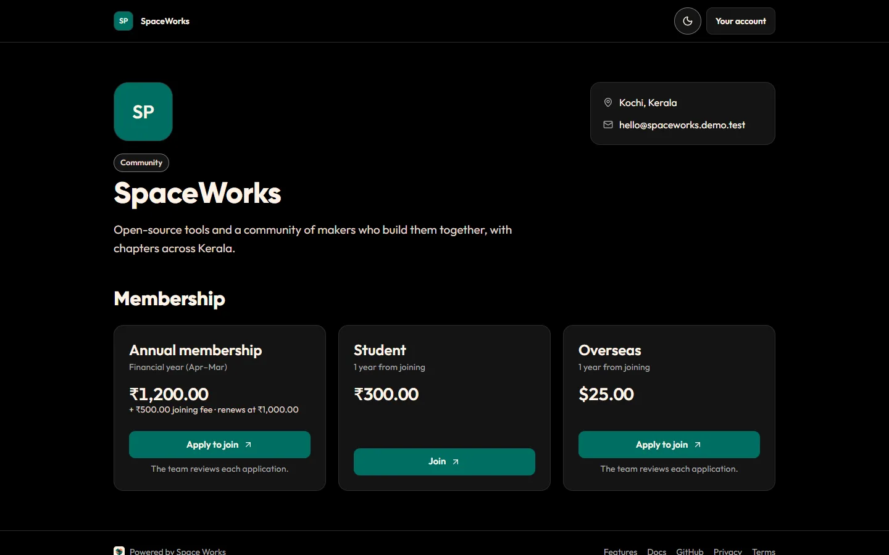
      <p><strong>Public page.</strong> Dark mode.</p>
    </td>
    <td width="50%" valign="top">
      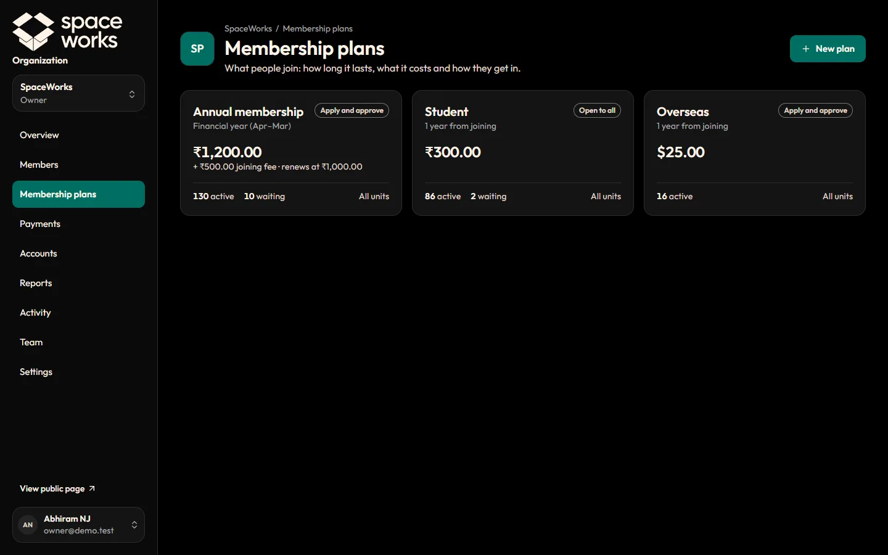
      <p><strong>Plans and join forms.</strong> Dark mode.</p>
    </td>
  </tr>
  <tr>
    <td width="50%" valign="top">
      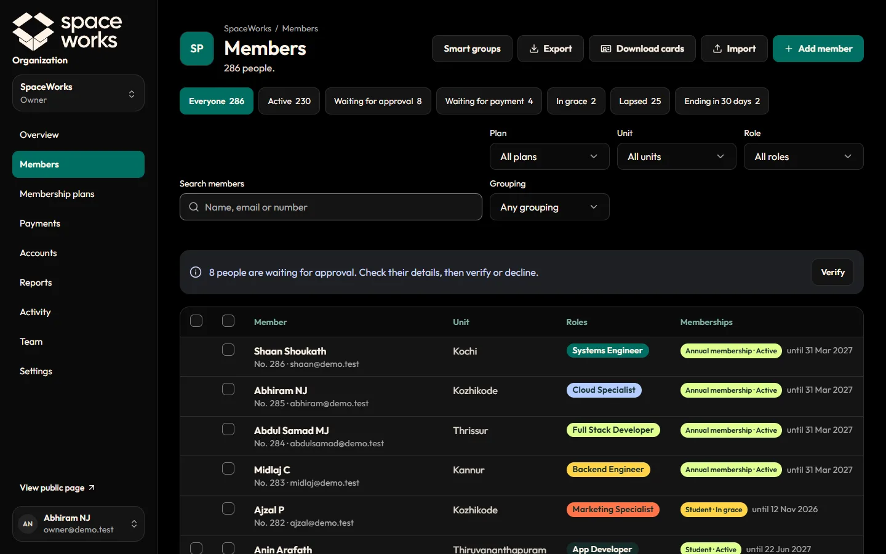
      <p><strong>Members.</strong> Dark mode.</p>
    </td>
    <td width="50%" valign="top">
      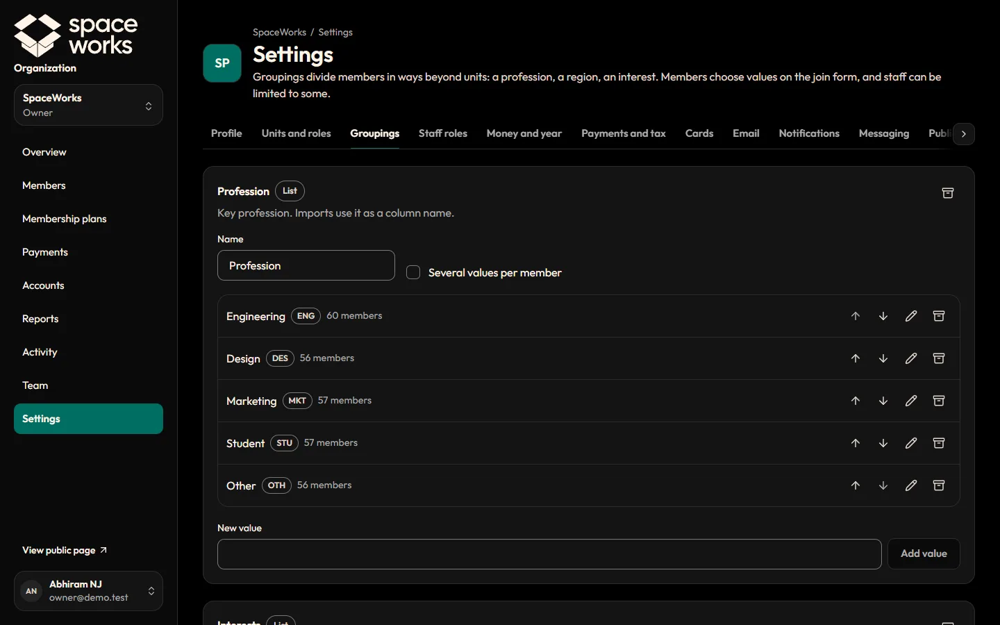
      <p><strong>Groupings.</strong> Dark mode.</p>
    </td>
  </tr>
  <tr>
    <td width="50%" valign="top">
      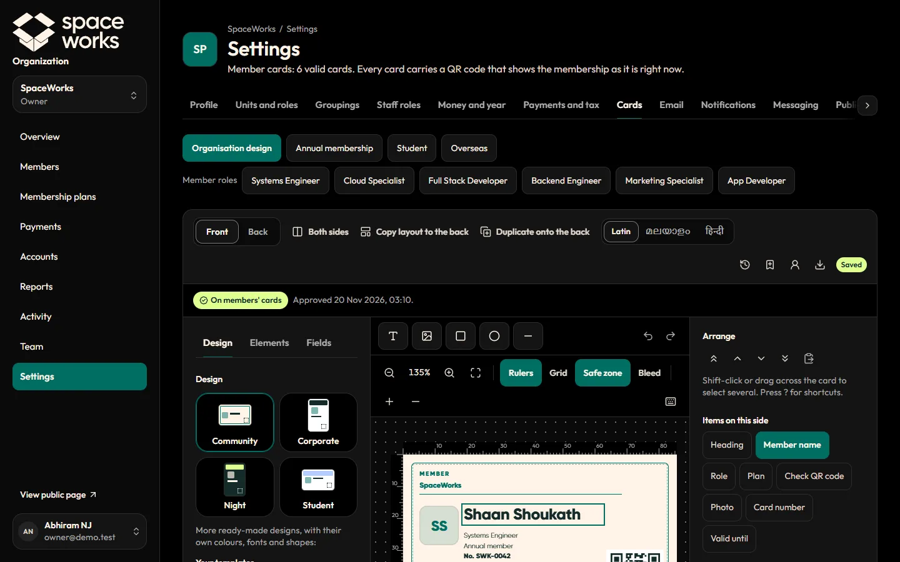
      <p><strong>Card designer.</strong> Dark mode.</p>
    </td>
    <td width="50%" valign="top">
      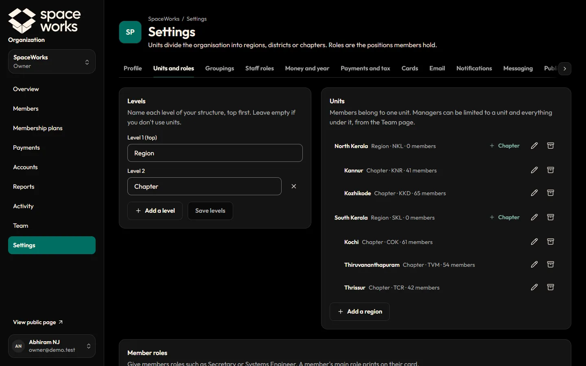
      <p><strong>Units.</strong> Dark mode.</p>
    </td>
  </tr>
  <tr>
    <td width="50%" valign="top">
      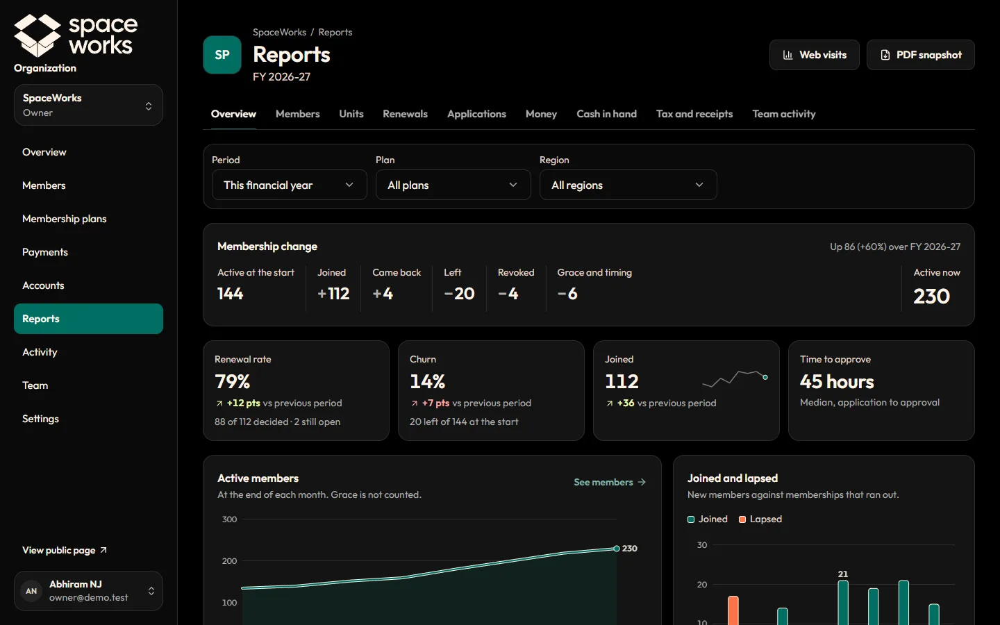
      <p><strong>Reports.</strong> Dark mode.</p>
    </td>
    <td width="50%" valign="top">
      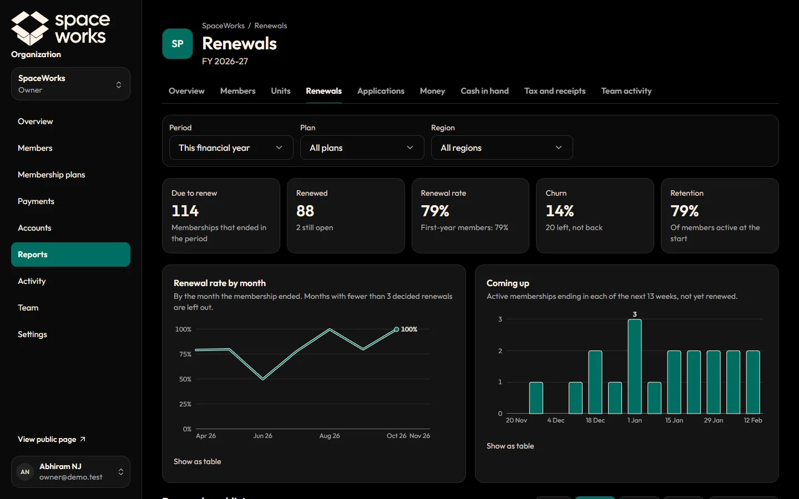
      <p><strong>Renewals.</strong> Dark mode.</p>
    </td>
  </tr>
</table>

</details>

Screenshots come from the demo data (`npm run db:seed-demo` and `npm run db:seed-reports`), captured by
`scripts/capture-screens.mjs` and copied here by `node scripts/generate-readme-art.mjs`. The organisations are fictional and the
members are the Space Works team and made-up people; every email, UPI ID and GSTIN is made up.

## Quickstart

On a 64-bit Linux server (or macOS / Windows with Docker Desktop running), as a user with `sudo`:

```bash
curl -fsSL https://raw.githubusercontent.com/SpaceWorks-Labs/SpaceWorks-Organization/main/install.sh | bash
```

It asks every question first, shows a summary, and changes nothing until you confirm. You need a 64-bit (x86_64 or
arm64) machine with at least 8 GiB free disk, internet access to `github.com` and `ghcr.io`, an SMTP relay or email
service on a verified sending domain, and, for HTTPS, a domain pointing at the server with ports 80 and 443 open.
The installer sets up Docker if it is missing. The full walkthrough is under
[Install options and hosting](#install-options-and-hosting).

## Who it is for

- **Clubs, associations and societies** that collect yearly or rolling fees and keep a register by hand.
- **Alumni bodies and federations** organised into regions, chapters or branches, with local committees.
- **Treasurers** who need GST-correct receipts, gapless numbering and a receipts and payments account.
- **Platform operators** who want to host many organisations on one server, reviewing the ones that apply.

## What you can do

Grouped the way an organisation's year actually goes.

### Plans and joining

- Fixed (financial year) or rolling plans with prices in integer paise, joining fees, renewal prices and other
  currencies.
- **Payment modes** per plan: free, online or in hand, or in hand only, with renewal conditions per plan.
- Join forms shaped per plan: your own questions (including "choose several", sections and questions shown only when
  an earlier answer matches), groupings chosen on the form, an optional or required photo, and open, approval-only or
  invitation-only joining, with consent recorded.

### Members, units and groupings

- A member register with search, filters, bulk approvals, CSV or Google Sheets import and a full export.
- **Units** up to four levels deep (for example Area → Unit), with staff limited to their own subtree.
- **Groupings** for any other dimension (profession, interests, batch), lists or trees, single or multiple, and
  **smart groups** built from AND, OR and NOT rules. Staff can be limited by grouping too.
- A membership sweep that moves people through grace and lapse.

### Payments, receipts and accounts

- Razorpay or Stripe on the organisation's own account, or UPI, bank transfer and cash, with per-unit payment
  instructions and a collection sheet for collectors.
- Maker-checker: a member or one staff member records a payment, another confirms it.
- **Gapless receipt numbers**, tax invoices with CGST and SGST or IGST, bills of supply and credit notes. Refund
  requests with a policy, and other receipts and expenses in a receipts and payments account.

### Messages and reminders

- Renewal reminders, receipts and notices on **email, SMS, WhatsApp, Telegram, Slack, Discord and Mattermost**, sent
  on the first channel each member has linked and opted into, configured per organisation or platform-wide.
- Each organisation's own wording for member emails, plus team chat alerts for staff.

### Member cards and /verify

- One card per member and plan, drawn live from the design: wallet, downloads, emails and bulk print.
- A **Canva-style editor** where the front and back work the same: shapes, bands, badges, icons, QR, barcodes and
  photo frames, with a brand kit, a logo maker, 30 saved versions, your own templates and owner approval.
- **Per-area cards:** a unit can have its own design, card number series and contact details (email, phone and
  website) on the card back, ahead of the plan's and the organisation's.
- A verify QR on every card: anyone sees Valid, Expired, Revoked or Replaced; staff who scan it see the member.

### Certificates

- Design numbered certificates (A4 or Letter, landscape or portrait) in the card editor's layers, with placeholders
  for the member's name, title, reason and date, and owner approval before any is issued.
- Issue to chosen members, a plan or a smart group, email each member the PDF, download PDF or PNG, or take a batch
  as a ZIP; revoke with a reason. Each has a QR to a public check page, and members see theirs in their account.

### Member portal

- Members sign in once and see every organisation they belong to: status, history, cards and receipts.
- Pay what is due, renew, update their details, ask for a refund, export their data or ask to be erased.
- Optional per organisation: with member accounts off, emails carry a secure pay link instead.

### Public pages, landing and docs

- A landing page, a features page and in-app docs for the platform, and a page per organisation built in a **live
  visual editor**: click text on the page to change it, drag blocks into order, preview in light or dark on desktop,
  tablet or phone, and let drafts autosave until you publish. Each publish is kept in a version history you can
  restore from.
- Twenty-eight block types: hero, call to action, plans, live numbers, an areas directory, columns, icon lists,
  badges, a members' area preview, sample card, committee, testimonials, timeline and more.
- **Area pages:** every unit gets its own page at `/o/<slug>/a/<CODE>`, drawn from the same published page with
  that area's plans, numbers and contact details.

### Reports and analytics

- Membership change, renewal rate, churn, joins and lapses, money by plan, GST summaries and breakdowns by grouping,
  for the platform, each organisation and each unit. PDF snapshots and CSV exports. Super admins see aggregates only.
- **Platform analytics** for the super admin: Growth, Money (per currency), Organisations (a sortable ranking) and
  Operations (outbox, email, messages, sign-ins, jobs and storage) tabs, each against the previous period.

## Integrations

| Area | Supported |
|---|---|
| Payments | Razorpay, Stripe, UPI QR, bank transfer and cash |
| Email | SMTP, Amazon SES, Resend, Postmark (platform-wide or per organisation), with bounce and complaint webhooks |
| SMS | Twilio, MSG91 |
| Member and team chat | WhatsApp (approved templates), Telegram, Slack, Discord, Mattermost, signed webhooks |
| Sign-in | Email and password (on by default), passkeys, phone codes, Google, Apple, GitHub, any OIDC provider, SAML, Supabase Auth, Firebase Auth |
| Background jobs | BullMQ with Redis (servers), Inngest (fully cloud), or a Cloudflare Worker cron |
| Storage | Silo (bundled), Cloudflare R2 or any S3-compatible bucket |
| Web analytics | Plausible, Umami, GA4, Firebase Analytics and Performance, PostHog, Clarity, Sentry, Mixpanel; all off until configured and consented |
| Import | CSV and Google Sheets |

## Areas

Each area has its own page in the in-app docs and in [`docs/features/`](docs/features):
[Organisations](docs/features/organisations.md) · [Plans and join forms](docs/features/plans-and-join-forms.md) ·
[Units](docs/features/units.md) · [Groupings](docs/features/groupings.md) ·
[Staff and roles](docs/features/staff-and-roles.md) · [Payments](docs/features/payments.md) ·
[Receipts and refunds](docs/features/receipts-and-refunds.md) · [Renewals](docs/features/renewals.md) ·
[Notifications](docs/features/notifications.md) · [Member cards](docs/features/member-cards.md) ·
[Certificates](docs/features/certificates.md) · [Member portal](docs/features/member-portal.md) · [Public page](docs/features/public-page.md) ·
[Reports and analytics](docs/features/reports-and-analytics.md) · [Web analytics](docs/features/web-analytics.md) ·
[Sign-in](docs/features/sign-in.md) · [Self-hosting](docs/features/self-hosting.md).
How they connect (what a settled payment or an approval updates elsewhere) is in
[feature interconnections](docs/reference/feature-interconnections.md).

## Install options and hosting

| Option | What runs where | Guide |
|---|---|---|
| **One server (VPS)** | Everything in Docker Compose on your server | [DEPLOYMENT_VPS.md](docs/DEPLOYMENT_VPS.md) |
| **Free, behind Cloudflare** | Your machine or a small server, with Cloudflare Tunnel, R2 and Resend | [DEPLOYMENT_CLOUDFLARE.md](docs/DEPLOYMENT_CLOUDFLARE.md) |
| **Cloud** | App, worker and beat on any Docker host with managed PostgreSQL, Redis, S3 and email | [DEPLOYMENT_CLOUD.md](docs/DEPLOYMENT_CLOUD.md) |
| **Split website** | The website on Netlify, every database, payment and email operation on your server | [DEPLOYMENT_NETLIFY.md](docs/DEPLOYMENT_NETLIFY.md) |
| **Local** | `bash setup.sh` (or `setup.ps1` on Windows) from a checkout | below |

Release images are the backend, `ghcr.io/spaceworks-labs/spaceworks-organization-backend` (app, migrations, worker,
beat and operator checks, by role), and the frontend, `ghcr.io/spaceworks-labs/spaceworks-organization-frontend`
(the website alone, for split hosting). The bundled stack pins PostgreSQL 16, Redis 7, Silo object storage (the
maintained, S3-compatible fork of MinIO) and the Caddy web edge, each speaking TLS signed by the install's own private
CA.

### Background jobs: BullMQ or Inngest

Reminders, the membership sweep, payment checks and email delivery run in the background, in one of two ways:

| Option | How it runs | Best for |
|---|---|---|
| **BullMQ worker and beat** (default) | Two long-running processes from the backend image, with the queues in Redis, included in every Compose layout | A server, or any host that keeps processes running; messages go out within seconds |
| **Inngest** (fully cloud) | Inngest calls `/api/inngest` once a minute and the app runs the due jobs there, on its free plan | Hosts that run only the web service, such as free container plans |

Pick one per installation; see [Fully cloud with Inngest](docs/DEPLOYMENT_CLOUD.md#fully-cloud-with-inngest). Without an
Inngest account, a free Cloudflare Worker cron (`deploy/cloudflare-cron`) can drive the same jobs.

### The installer

All deployment decisions come first, in this order:

1. **GitHub repository** to install and update from (`SpaceWorks-Labs/SpaceWorks-Organization`, or your fork).
2. **Website here?** Yes (default), or backend only with the website on Netlify.
3. **Web edge:** plain HTTP for a LAN or trial (default), automatic HTTPS with Caddy and Let's Encrypt, an existing
   reverse proxy forwarding to `127.0.0.1:8080`, or Cloudflare Tunnel.
4. **Storage:** bundled Silo (default), or an external S3-compatible bucket.
5. **Super-admin email and password** (asked twice, hidden), then **email** settings.
6. **Sign-in options** besides email and password.
7. **A GitHub Actions runner on this server for automatic deploys? [y/N]** (Linux with systemd only).

One summary shows every choice before **Proceed? [Y/n]**. Secrets are generated, saved in the install's owner-only
`.env` and never printed. Production contains no demo data. To install from a fork, add
`bash -s -- --repo YourName/SpaceWorks-Organization` to the curl command; the fork must have published a release.

Run the same command later and an existing install shows a menu: update, back up, roll back, check status and health,
backups and off-site copies, change settings, server security, automatic deploys, recover super-admin access, support
bundle and uninstall. Each option is a script in `scripts/` you can also run directly.

### Updating

Every merge to `main` raises `VERSION` and builds a release: `.github/workflows/release.yml` runs the tests,
publishes the images and a GitHub release titled `Space Works Organization <VERSION>`, then promotes the images to
`latest`. Pushes to `dev` publish images tagged `dev`, never `latest`.

```bash
bash scripts/update.sh --force                 # newest release; backs up, migrates, health-checks
bash scripts/update.sh --force --version <v>   # an exact published release
bash scripts/update.sh --rollback              # the release that ran before the last update
```

A failed update restores the previous host files and images automatically. A runner on your server can deploy each
release for you without opening a port; see [DEPLOYMENT_VPS.md](docs/DEPLOYMENT_VPS.md). The repository is public, so
require approval for outside contributors' workflow runs and never give the runner's label to a `pull_request`
workflow ([SECURITY.md](docs/SECURITY.md)).

## Architecture

One Next.js 16 application (App Router, React Server Components, Server Actions, React 19, TypeScript strict) on
PostgreSQL 16 through Prisma 6, with Redis for rate limits, the read cache and BullMQ jobs, S3-compatible storage for
uploads, and a SQL outbox for every email, message and webhook. Tenant isolation is enforced in the application:
every row carries its organisation, every query is scoped to it, and cross-tenant access answers 404.

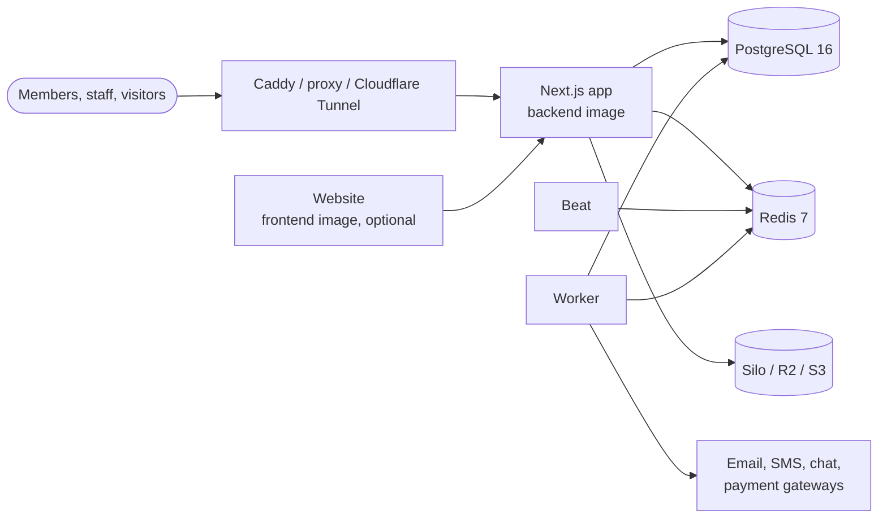

The details, including the release images and roles, are in [ARCHITECTURE.md](docs/ARCHITECTURE.md).

## API

Not yet: there is no public REST API. The routes under `/api` serve payment gateways, email, SMS and chat providers,
the job scheduler, health checks and the split-hosting website; each is listed with how it is checked in
[webhooks and internal endpoints](docs/reference/webhooks-and-endpoints.md). A public API is on the
[roadmap](#roadmap).

## Roles and access

- **Super admins** run the platform. They are created only on the server (`scripts/admin.sh`) and sign in with
  email and password; with an authenticator set up, they can act in any organisation as its owner, and every such
  visit is audited.
- **Owners** hold every permission in their organisation and approve card designs.
- **Staff roles** are defined per organisation from a fixed permission list. Manager, Treasurer and Viewer are the
  starting roles. Staff can be limited to a unit's subtree or to grouping values, and can only grant less than they
  hold. Every staff member needs an authenticator.
- **Members** sign in to the portal with their verified email and see only their own records.

See [Staff and roles](docs/features/staff-and-roles.md) and [SECURITY.md](docs/SECURITY.md).

## Design system

Space Works Organization follows the [Space Works design system](https://spaceworks-labs.github.io/SpaceWorks-Design-System/)
([repository](https://github.com/SpaceWorks-Labs/SpaceWorks-Design-System)): Outfit for body and UI, Gilroy ExtraBold
for display headings, 10 px controls, light and dark themes with the circle reveal, and reduced motion respected
everywhere. The brand files are synced from a pinned design-system release with `npm run design:sync`, and
`brand/SOURCE.json` records the exact commit. How the product applies it, including Patch the painted wolf and every
easter egg, is in [DESIGN.md](docs/DESIGN.md).

## Documentation

- **In the app:** `/docs` has quickstarts for operators, owners and members, a manual for each role, hosting guides
  and a reference, with search. The same pages live in [`docs/`](docs): [guides](docs/guides),
  [manuals](docs/manuals), [features](docs/features) and [reference](docs/reference).
- **Operating:** [VPS](docs/DEPLOYMENT_VPS.md) · [Cloudflare](docs/DEPLOYMENT_CLOUDFLARE.md) ·
  [cloud](docs/DEPLOYMENT_CLOUD.md) · [Netlify](docs/DEPLOYMENT_NETLIFY.md) ·
  [configuration](docs/CONFIGURATION.md) (every environment variable).
- **Design and rules:** [architecture](docs/ARCHITECTURE.md) · [security](docs/SECURITY.md) ·
  [payments](docs/PAYMENTS.md) · [GST](docs/GST.md) · [reports](docs/REPORTS.md) ·
  [notifications](docs/NOTIFICATIONS.md) · [design](docs/DESIGN.md).
- **Releases:** [changelog](CHANGELOG.md) and the release notes in `docs/release-*.md`.

## Roadmap

- A public API with an OpenAPI description.
- Wallet passes for member cards, and bulk card printing by smart group.
- Standalone forms (surveys and registrations) beyond the join form.
- Alt text inside card PDFs, and a phone layout for the card editor.

Plans for larger pieces of work live in [`docs/plans/`](docs/plans).

## Contributing

Node 22 and Docker:

```bash
cp .env.example .env
docker compose up -d        # PostgreSQL and Redis for development
npm ci
npm run db:migrate
npm run dev                 # http://localhost:3000
```

CI runs `npm run lint`, `npm run typecheck`, `npm run test:unit`, the integration and Playwright suites, and
`bash scripts/compose-smoke.sh` (the bundled stack end to end). Conventions are in [CLAUDE.md](CLAUDE.md) (the same
file as [AGENTS.md](AGENTS.md)), decisions in [docs/decisions.md](docs/decisions.md), and the security policy in
[docs/SECURITY.md](docs/SECURITY.md). A code of conduct: not yet.

## Licence

Copyright © 2026 Space Works.

Space Works Organization is free software under the
[GNU Affero General Public License v3.0 or later](LICENSE) (`AGPL-3.0-or-later`). If you run a modified version for
other people over a network, you must offer them its source code too. See [NOTICE](NOTICE) for attribution. The fonts
in `public/brand/fonts` and `public/fonts`, and Patch's artwork, keep their own terms and are not covered by the AGPL.
